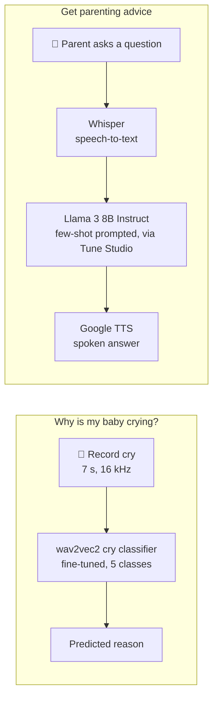

# NurtureNest: AI-Powered Parenting Assistant

🏆 **1st Place, NextGen LLM Challenge @ HackMIT (Sept 2024)**

NurtureNest is a voice assistant for new parents. It listens to a baby's cry, predicts the
likely reason (hungry, tired, needs burping, belly pain, or discomfort), and answers spoken
parenting questions with brief advice from a fine-tuned LLM, read back aloud.

> *"Because every cry has a reason, and now, an answer."*

---

## How it works

The app has two modes, shown as two tabs in a Streamlit web interface.



**1. Cry classification.** `facebook/wav2vec2-base` was fine-tuned for audio classification on
the [Donate-a-Cry corpus](data/donateacry/) (105 labelled cry recordings across 5 classes),
using an 80/20 train/test split.

**2. Parenting advice.** The parent's question is transcribed with `faster-whisper` and sent to
Llama 3 8B Instruct on Tune Studio. The model is guided by prompt engineering with few-shot
infant-care conversation examples ([examples](training/llm_prompt_examples/)), and the answer is
spoken back with gTTS.

## Results

- Cry classifier: **82% accuracy** on the held-out test split.
- Won **1st place** in the NextGen LLM Challenge at HackMIT 2024.

## Tech stack

<p>
  
  
  
  
  
  
</p>

| Component | Technology |
|---|---|
| Cry classification | wav2vec2-base (Hugging Face Transformers), fine-tuned |
| Speech-to-text | faster-whisper (Whisper base) |
| Language model | Llama 3 8B Instruct with few-shot prompting, hosted on Tune Studio |
| Text-to-speech | gTTS (Google Text-to-Speech) |
| Web interface | Streamlit |

## Repository structure

```
NurtureNest/
├── app/
│   └── app.py                        # Streamlit app (both modes)
├── training/
│   ├── train_cry_classifier.py       # Fine-tunes wav2vec2 on the cry dataset
│   └── llm_prompt_examples/          # Few-shot conversation examples for the advice LLM
├── models/
│   └── cry-classifier/               # Classifier config (weights: see models/README.md)
├── data/
│   └── donateacry/                   # Infant cry audio, one folder per class
├── requirements.txt
└── .env.example                      # API key template
```

## Run it locally

```bash
pip install -r requirements.txt

# 1. Train the cry classifier (weights are not stored in the repo)
python training/train_cry_classifier.py

# 2. Add your Tune Studio API key
cp .env.example .env     # then edit TUNE_API_KEY

# 3. Launch the app
streamlit run app/app.py
```

The app records from your computer's microphone, so run it locally rather than on a server.

## Team

| Member | Contribution |
|---|---|
| **Bijyeta Maharjan** | Audio classification: fine-tuned wav2vec2 on the labelled cry dataset, training and testing (82% test accuracy) |
| **Janet** | Prompt engineering for the parenting-advice LLM (few-shot prompting) |
| **Riya** | Prompt engineering for the parenting-advice LLM (few-shot prompting) |
| **Florida** | Frontend (Streamlit web interface) |

## Acknowledgements

- **Tune AI** for hosting and deployment support for the LLM via Tune Studio.
- **Dataset:** [Donate-a-Cry corpus](https://github.com/gveres/donateacry-corpus), in the cleaned
  version by Rizal, Jan, Dürlich, and Chen (KTH), licensed under the
  [Open Database License](http://opendatacommons.org/licenses/odbl/1.0/). See
  [`data/donateacry/README.md`](data/donateacry/README.md).

## Disclaimer

NurtureNest is a hackathon prototype and is not medical advice. Consult a pediatrician about
any concerns with your baby's health.
